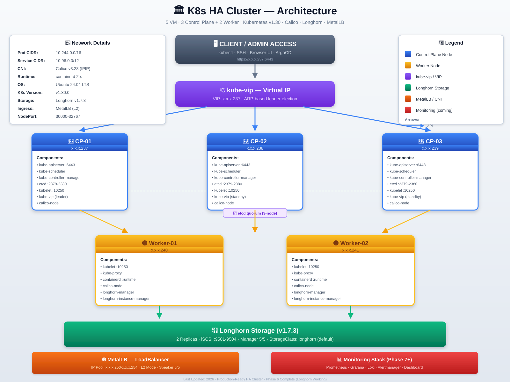

# K8s HA Cluster — Complete Hands-On Guide

**Real-world journey: 5 VM (3 CP + 2 Worker) Production-Ready Kubernetes Cluster**

[](https://kubernetes.io)
[](https://www.tigera.io)
[](https://longhorn.io)
[](https://ubuntu.com)

---

## **Important:** Before you install Kubernetes, you **must** learn the basic components.  
> Attempting to install without understanding the architecture leads to misdiagnosing networking problems as Kubernetes problems.

🔗 **[Kubernetes Zero to Advanced — Complete Component Guide](https://github.com/alhajcse/k8s-ha-cluster/blob/master/kubernetes_zero_to_advanced_complete_component_guide.md)**

This guide covers:

- Architecture, Components, Networking, Storage, Security, HA, Observability & Troubleshooting
- **Level:** Beginner to Advanced
- **Purpose:** Understand what each important Kubernetes component is, why it is needed, how components interact, what happens when a component fails, and how to troubleshoot step by step.

---


## Table of Contents

- [Architecture Overview](#-architecture-overview)
- [VM Specifications](#-vm-specifications)
- [Phase 1: VM Preparation](#-phase-1-vm-preparation)
- [Phase 2: K8s Cluster Bootstrap](#-phase-2-k8s-cluster-bootstrap)
- [Phase 3: Calico CNI + Network Fixes](#-phase-3-calico-cni--network-fixes)
- [Phase 4: Metrics Server](#-phase-4-metrics-server)
- [Phase 5: Longhorn Storage](#-phase-5-longhorn-storage)
- [Phase 6: MetalLB + Ingress](#-phase-6-metallb--ingress)
- [Problem-Solution Matrix](#-problem-solution-matrix)
- [Daily Operations](#-daily-operations)
- [Lessons Learned](#-lessons-learned)

---

## Architecture Overview




**Stack:**
- **CNI:** Calico v3.28 (IPIP mode)
- **Storage:** Longhorn v1.7.3
- **Load Balancer:** kube-vip + MetalLB
- **Metrics:** Metrics Server

---

## VM Specifications

| VM | IP | Role | vCPU | RAM | Disk |
|---|---|---|---|---|---|
| CP-01 | x.x.x.237 | Control Plane | 2 | 4 GB | 50 GB |
| CP-02 | x.x.x.238 | Control Plane | 2 | 4 GB | 50 GB |
| CP-03 | x.x.x.239 | Control Plane | 2 | 4 GB | 50 GB |
| Worker-01 | x.x.x.240 | Worker | 2 | 4 GB | 50 GB |
| Worker-02 | x.x.x.241 | Worker | 2 | 4 GB | 50 GB |

**OS:** Ubuntu 24.04 LTS
**K8s:** v1.30.0
**Runtime:** containerd 2.x

---

## Phase 1: VM Preparation

Based on the 🔗 **[kvm-ha-cluste](https://github.com/alhajcse/kvm-ha-cluster)**
 repository — assuming VMs are already provisioned. This guide covers configuring those VMs for a Kubernetes cluster.

### 1.1 Ansible + Terraform Install

```bash
# ------------------------------------------------------------
# Ansible install
# ------------------------------------------------------------
sudo apt update
sudo apt install -y software-properties-common
sudo add-apt-repository --yes --update ppa:ansible/ansible
sudo apt install -y ansible

# Verify
ansible --version
# Expected: ansible [core 2.16.x]

# Extra tools
sudo apt install -y sshpass netcat-openbsd jq tree htop git curl wget vim

# Ansible collections
ansible-galaxy collection install community.general
ansible-galaxy collection install ansible.posix
ansible-galaxy collection install kubernetes.core

# ------------------------------------------------------------
# Terraform install
# ------------------------------------------------------------
wget -O- https://apt.releases.hashicorp.com/gpg | \
    sudo gpg --dearmor -o /usr/share/keyrings/hashicorp-archive-keyring.gpg

echo "deb [signed-by=/usr/share/keyrings/hashicorp-archive-keyring.gpg] \
https://apt.releases.hashicorp.com $(lsb_release -cs) main" | \
    sudo tee /etc/apt/sources.list.d/hashicorp.list

sudo apt update
sudo apt install -y terraform

terraform --version
```
Ansible will be installed from the official PPA (ppa:ansible/ansible).
Terraform will be installed from the HashiCorp APT repository.
Additional CLI tools (`sshpass`, `netcat-openbsd`, `jq`, `tree`, `htop`, `git`, `curl`, `wget`, `vim`) will be installed.
Required Ansible collections (community.general, ansible.posix, kubernetes.core) will be installed.
Result: Your machine becomes an Ansible control node and has Terraform ready for infrastructure provisioning.


### 1.2 SSH Key Setup

```bash
# Key Create
ls ~/.ssh/id_ed25519 || ssh-keygen -t ed25519 -N "" -f ~/.ssh/id_ed25519

# Copy ALL VM
for ip in 237 238 239 240 241; do
    echo "→ x.x.x.$ip"
    ssh-copy-id vm@x.x.x.$ip
done

# Verify
for ip in 237 238 239 240 241; do
    echo -n "x.x.x.$ip → "
    ssh -o ConnectTimeout=3 -o BatchMode=yes vm@x.x.x.$ip "hostname"
done
```
## Key generation
- If ~/.ssh/id_ed25519 does not exist, a new ED25519 key pair is generated without a passphrase (-N "").
- If the key already exists, it is not overwritten (ls ... || ssh-keygen ...).

## Copy public key to VMs
For each IP in the list 237 238 239 240 241:
- `ssh-copy-id vm@x.x.x.$ip` is executed.
- You will be prompted for the password of user vm on each VM (unless passwordless SSH is already set up).
- The public key is appended to ~vm/.ssh/authorized_keys on each VM.
- The SSH host key of each VM is added to ~/.ssh/known_hosts (if not already present).

## Verification
For each IP:
- An SSH connection is attempted with BatchMode=yes (no password prompt).
- The command hostname is run on the remote VM.
- If successful, the output is: x.x.x.237 → <hostname>.
- If it fails, you will see an error like Permission denied or Connection timed out.
  
Result: You now have passwordless SSH access from the control node to all five VMs (assuming the passwords were entered correctly and the network is reachable).


### 1.3 Firewall Configuration (CRITICAL!)

This script configures UFW (Uncomplicated Firewall) rules on all 5 Kubernetes VMs so that Kubernetes components, Calico CNI, and Longhorn storage can communicate with each other.
If any required port is blocked, the cluster will break — nodes will show NotReady, Pods will stay Pending, or networking/storage will fail silently.

> **Most important step — if you miss this port, the entire cluster will break.**

```bash

# UFW rules configuration all VM (5 Kubernetes machine)
for ip in 237 238 239 240 241; do
    echo "════════ x.x.x.$ip ════════"
    
    ssh vm@x.x.x.$ip 'sudo bash -s' <<'FIREWALL'
# ─────────────────────────────────────
# K8s core
# ─────────────────────────────────────
sudo ufw allow 22/tcp comment 'SSH'
sudo ufw allow 6443/tcp comment 'K8s API'
# Client → etcd port 2379 and etcd member-to-member communication port 2330
sudo ufw allow 2379:2380/tcp comment 'etcd'
# Control Plane communicate with Kubelet ->Containers/Pods
sudo ufw allow 10250/tcp comment 'kubelet'
sudo ufw allow 10257/tcp comment 'controller-mgr'
sudo ufw allow 10259/tcp comment 'scheduler'
sudo ufw allow 30000:32767/tcp comment 'NodePort'

# ─────────────────────────────────────
# Calico (CRITICAL!).BGP VXLAN IPIP not all for production
# ─────────────────────────────────────
sudo ufw allow 5473/tcp comment 'Calico Typha'      # ← MUST!
sudo ufw allow 179/tcp comment 'Calico BGP'
sudo ufw allow 4789/udp comment 'VXLAN'
sudo ufw allow 8472/udp comment 'Calico'
sudo ufw allow proto 4 from x.x.x.0/24 comment 'IPIP'  # ← MUST!

# ─────────────────────────────────────
# Longhorn (CRITICAL!)
# ─────────────────────────────────────
sudo ufw allow 9501:9504/tcp comment 'Longhorn'     # ← MUST!

# ─────────────────────────────────────
# Pod networks
# ─────────────────────────────────────
sudo ufw allow from 10.244.0.0/16 comment 'Pod network'
sudo ufw allow from 10.96.0.0/12 comment 'Service network'

sudo ufw --force enable
sudo ufw reload
FIREWALL
done
```

### 1.4 Ansible Playbook Run

Instead of manually SSH-ing into each of the 5 VMs to install packages, configure services, and set firewall rules, this single command applies the same configuration to all of them simultaneously.

This ensures your cluster is built on a **consistent baseline**, which is critical for stability and troubleshooting later.

### Roles Applied by `site.yml`

| Role | Purpose |
|------|---------|
| **OS Preparation** | Sets hostnames, updates packages, disables swap, loads kernel modules, applies sysctl settings required by Kubernetes. |
| **containerd** | Installs and configures the container runtime (containerd 2.x) that Kubernetes uses to run containers. |
| **k8s-tools** | Installs `kubeadm`, `kubelet`, and `kubectl`, pinned to version **v1.30.0**. |
| **Firewall** | Applies all UFW rules (API server, etcd, Calico, Longhorn, etc.) so cluster components can communicate. |

---

```bash
cd ~/k8s-project/ansible

# All role run (OS prep, containerd, k8s-tools, firewall)
ansible-playbook playbooks/site.yml

# Time: 10-15 mitutes
# If Success:
# PLAY RECAP
# k8s-cp-01   : ok=15 changed=8 unreachable=0 failed=0
```

**Verify:**

```bash
ansible k8s_cluster -m shell -a "systemctl is-active containerd kubelet"
```

---

## Phase 2: K8s Cluster Bootstrap

## 2.1 HA Cluster – HAProxy Setup (Alternative kube-vip)

> It uses **HAProxy** (and optionally **Keepalived**) to provide a highly available API server endpoint on port `6443`.

- **HAProxy** listens on `*:6443` and forwards traffic to the control plane nodes.
- **Keepalived** (optional) manages a VIP that floats between HAProxy nodes.
- The `controlPlaneEndpoint` in the `kubeadm` configuration points to the HAProxy address or VIP.

---

## Prerequisites

- All control plane nodes have `kubeadm`, `kubelet`, `kubectl`, and a container runtime (e.g., `containerd`) installed.
- The load balancer node(s) have network access to all control plane nodes on port `6443`.
- If using Keepalived, ensure the load balancer nodes can use VRRP (protocol 112) and share a common network interface.

---

### 2.1.2 Configure HAProxy

Edit `/etc/haproxy/haproxy.cfg`:

```haproxy

frontend kubernetes-frontend
    bind *:6443
    mode tcp
    option tcplog
    default_backend kubernetes-backend

backend kubernetes-backend
    mode tcp
    balance roundrobin
    option tcp-check
    server cp-01 x.x.x.237:6443 check
    server cp-02 x.x.x.238:6443 check
    server cp-03 x.x.x.239:6443 check
```

> Replace `x.x.x.237`, `x.x.x.238`, `x.x.x.239` with the actual IP addresses of your control plane nodes.

Restart and enable HAProxy:

```bash
sudo systemctl restart haproxy
sudo systemctl enable haproxy
```


### 2.2 Cluster Init (CP-01)

>  **For K8s v1.30 we have to used `v1beta3` API not — `v1beta4`**
> Run the following command on the first control plane node.  
**Important:** If HAProxy runs on a separate node/VIP, change `controlPlaneEndpoint` to the HAProxy address or VIP.  
The `advertiseAddress` should remain the IP of the control plane node itself.


```bash
ssh vm@x.x.x.237 'sudo bash -s' <<'INIT'
if [ -f /etc/kubernetes/admin.conf ]; then
    echo " Already initialized"
    exit 0
fi

cat > /root/kubeadm-config.yaml <<'CONFIG'
apiVersion: kubeadm.k8s.io/v1beta3    # ← v1beta3 for K8s 1.30
kind: ClusterConfiguration
kubernetesVersion: v1.30.0
controlPlaneEndpoint: "x.x.x.237:6443"
networking:
  podSubnet: "10.244.0.0/16"
  serviceSubnet: "10.96.0.0/12"
apiServer:
  certSANs:
    - "x.x.x.237"
    - "x.x.x.238"
    - "x.x.x.239"
    - "x.x.x.240"
    - "x.x.x.241"
    - "x.x.x.234"
    - "k8s-api.local"
etcd:
  local:
    dataDir: /var/lib/etcd
---
apiVersion: kubelet.config.k8s.io/v1beta1
kind: KubeletConfiguration
cgroupDriver: systemd
---
apiVersion: kubeadm.k8s.io/v1beta3
kind: InitConfiguration
localAPIEndpoint:
  advertiseAddress: x.x.x.237
  bindPort: 6443
nodeRegistration:
  criSocket: unix:///var/run/containerd/containerd.sock
CONFIG

kubeadm init --config /root/kubeadm-config.yaml --upload-certs 2>&1 | tee /root/kubeadm-init.log

mkdir -p /home/vm/.kube
cp /etc/kubernetes/admin.conf /home/vm/.kube/config
chown -R vm:vm /home/vm/.kube

echo " CP-01 initialized"
INIT
```

### 2.1.5 Verify

On the first control plane node:

```bash
kubectl get nodes
kubectl get pods -n kube-system
```

Check HAProxy statistics (if enabled):

```bash
echo "show stat" | sudo socat stdio /run/haproxy/admin.sock
```

---


## Components and Resources Installed by the Command

The command above performs two main tasks:
1. Writes a `kubeadm` configuration file to `/root/kubeadm-config.yaml`.
2. Runs `kubeadm init` to bootstrap the first control plane node.

### kubeadm Configuration File

| Field | Value | Purpose |
|-------|-------|---------|
| `kubernetesVersion` | `v1.30.0` | Pins the control plane to Kubernetes 1.30.0. |
| `controlPlaneEndpoint` | `"x.x.x.237:6443"` | API server endpoint used by all components. |
| `networking.podSubnet` | `"10.244.0.0/16"` | CIDR for Pod IPs. |
| `networking.serviceSubnet` | `"10.96.0.0/12"` | CIDR for Service IPs. |
| `apiServer.certSANs` | `x.x.x.237` … `x.x.x.241` | SANs added to the API server certificate. |
| `etcd.local.dataDir` | `/var/lib/etcd` | Data directory for the stacked etcd member. |
| `KubeletConfiguration.cgroupDriver` | `systemd` | Cgroup driver for the kubelet. |
| `InitConfiguration.localAPIEndpoint.advertiseAddress` | `x.x.x.237` | IP advertised by the API server. |
| `InitConfiguration.localAPIEndpoint.bindPort` | `6443` | API server listening port. |
| `nodeRegistration.criSocket` | `unix:///var/run/containerd/containerd.sock` | Container runtime socket. |

### Static Pods (in `/etc/kubernetes/manifests/`)

| Manifest | Component |
|----------|-----------|
| `kube-apiserver.yaml` | `kube-apiserver` |
| `kube-controller-manager.yaml` | `kube-controller-manager` |
| `kube-scheduler.yaml` | `kube-scheduler` |
| `etcd.yaml` | `etcd` (stacked) |

### Certificates and Keys (in `/etc/kubernetes/pki/`)

| Path | Description |
|------|-------------|
| `ca.crt` / `ca.key` | Cluster root CA |
| `apiserver.crt` / `apiserver.key` | API server serving certificate |
| `apiserver-kubelet-client.crt` / `.key` | API server → kubelet client |
| `front-proxy-ca.crt` / `.key` | Front-proxy CA |
| `front-proxy-client.crt` / `.key` | Front-proxy client |
| `etcd/ca.crt` / `ca.key` | etcd CA |
| `etcd/server.crt` / `.key` | etcd server certificate |
| `etcd/peer.crt` / `.key` | etcd peer certificate |
| `etcd/healthcheck-client.crt` / `.key` | etcd health-check client |
| `apiserver-etcd-client.crt` / `.key` | API server → etcd client |
| `sa.key` / `sa.pub` | Service Account key pair |

### kubeconfig Files (in `/etc/kubernetes/`)

| File | Purpose |
|------|---------|
| `admin.conf` | Cluster administrator kubeconfig |
| `kubelet.conf` | kubelet kubeconfig |
| `controller-manager.conf` | controller-manager kubeconfig |
| `scheduler.conf` | scheduler kubeconfig |

### Bootstrap Tokens and ConfigMaps

| Resource | Location |
|----------|----------|
| Bootstrap token | Secret in `kube-system` (`bootstrap-token-xxxxxx`) |
| `kubeadm-config` | ConfigMap in `kube-system` |
| `kubelet-config` | ConfigMap in `kube-system` |
| `kubeadm-certs` | Secret in `kube-system` (due to `--upload-certs`) |

### etcd Data

- `/var/lib/etcd` – populated with etcd data files.

### Container Images Pulled

- `registry.k8s.io/kube-apiserver:v1.30.0`
- `registry.k8s.io/kube-controller-manager:v1.30.0`
- `registry.k8s.io/kube-scheduler:v1.30.0`
- `registry.k8s.io/etcd:3.5.x-0`
- `registry.k8s.io/pause:3.9`
- `registry.k8s.io/coredns/coredns:v1.11.x`
- `registry.k8s.io/kube-proxy:v1.30.0`

### CoreDNS and kube-proxy

- **CoreDNS**: Deployment in `kube-system` (2 replicas by default).
- **kube-proxy**: DaemonSet in `kube-system`.

### Post-init Actions

| Action | Details |
|--------|---------|
| Creates `/home/vm/.kube` | Directory for the `vm` user's kubeconfig. |
| Copies `admin.conf` → `/home/vm/.kube/config` | Grants `vm` cluster-admin access. |
| Sets ownership to `vm:vm` | Ensures the `vm` user can read the kubeconfig. |
| Prints "CP-01 initialized" | Indicates success. |

---

## Summary of Installed Resources

| Category | Resources |
|----------|-----------|
| **Static Pods** | `kube-apiserver`, `kube-controller-manager`, `kube-scheduler`, `etcd` |
| **Certificates / Keys** | CA, API server, etcd, front-proxy, service account, etc. |
| **kubeconfigs** | `admin.conf`, `kubelet.conf`, `controller-manager.conf`, `scheduler.conf` |
| **ConfigMaps / Secrets** | `kubeadm-config`, `kubelet-config`, bootstrap token, `kubeadm-certs` |
| **Add-ons** | CoreDNS (Deployment), kube-proxy (DaemonSet) |
| **Data Directory** | `/var/lib/etcd` |
| **Container Images** | kube-apiserver, kube-controller-manager, kube-scheduler, etcd, pause, CoreDNS, kube-proxy |
| **Networking** | Pod subnet (`10.244.0.0/16`), Service subnet (`10.96.0.0/12`) — no CNI plugin installed by this command alone. |

---


### 2.3 Join Commands Save

```bash
# Worker join
ssh vm@x.x.x.237 "sudo kubeadm token create --print-join-command" | tail -1 > /tmp/worker-join.txt

# CP join
CP_TOKEN=$(ssh vm@x.x.x.237 "sudo kubeadm token create" | tail -1)
CERT_KEY=$(ssh vm@x.x.x.237 "sudo kubeadm init phase upload-certs --upload-certs 2>&1 | tail -1")
CA_HASH=$(ssh vm@x.x.x.237 "openssl x509 -pubkey -in /etc/kubernetes/pki/ca.crt | openssl rsa -pubin -outform der 2>/dev/null | openssl dgst -sha256 -hex | sed 's/^.* //'")

cat > /tmp/cp-join.txt <<EOF
kubeadm join x.x.x.237:6443 --token $CP_TOKEN --discovery-token-ca-cert-hash sha256:$CA_HASH --control-plane --certificate-key $CERT_KEY
EOF

echo " Join commands saved"
```

### 2.4 Join CP-02, CP-03, Workers

```bash
# CP-02
ssh vm@x.x.x.238 "sudo $(cat /tmp/cp-join.txt) --apiserver-advertise-address x.x.x.238 --node-name k8s-cp-02"

# CP-03
ssh vm@x.x.x.239 "sudo $(cat /tmp/cp-join.txt) --apiserver-advertise-address x.x.x.239 --node-name k8s-cp-03"

# Workers
ssh vm@x.x.x.240 "sudo $(cat /tmp/worker-join.txt)"
ssh vm@x.x.x.241 "sudo $(cat /tmp/worker-join.txt)"
```

** Verify:**

```bash
ssh vm@x.x.x.237 "kubectl get nodes"
```

**Expected (5 NotReady):**

```
NAME            STATUS     ROLES           AGE   VERSION
k8s-cp-01       NotReady   control-plane   5m    v1.30.0
k8s-cp-02       NotReady   control-plane   3m    v1.30.0
k8s-cp-03       NotReady   control-plane   2m    v1.30.0
k8s-worker-01   NotReady   <none>          1m    v1.30.0
k8s-worker-02   NotReady   <none>          30s   v1.30.0
```

---

## Phase 3: Calico CNI + Network Fixes

Kubernetes cluster already initialized (Phase 1–2). This phase installs Calico as the CNI, fixes the Typha port 5473 firewall block

### 3.1 Calico Install (CP-01)

```bash
ssh vm@x.x.x.237 'bash -s' <<'CALICO'
export KUBECONFIG=/home/vm/.kube/config

# Tigera operator
kubectl create -f https://raw.githubusercontent.com/projectcalico/calico/v3.28.0/manifests/tigera-operator.yaml

kubectl wait --for=condition=Available deployment/tigera-operator \
    -n tigera-operator --timeout=300s

# Installation
cat <<'YAML' | kubectl apply -f -
apiVersion: operator.tigera.io/v1
kind: Installation
metadata:
  name: default
spec:
  calicoNetwork:
    ipPools:
      - blockSize: 26
        cidr: 10.244.0.0/16
        encapsulation: IPIP
        natOutgoing: Enabled
        nodeSelector: all()
YAML

kubectl wait --for=condition=Ready pods --all -n calico-system --timeout=600s

echo " Calico installed"
kubectl get nodes
CALICO
```
Commands are run from an admin workstation that SSHes into x.x.x.237 (the bootstrap CP node). All kubectl calls target the cluster via that node's kubeconfig. Tigera Operator automatically create a `calico-node` Pod each Node.

### 3.2 Problem: calico-node pods 0/1 Stuck

**Symptom:**

```bash
kubectl get pods -n calico-system -l k8s-app=calico-node
```

```
calico-node-4q7zk   1/1   Running   yes
calico-node-fsphh   0/1   Running   no
calico-node-sqwhk   0/1   Running   no
```

**Log :**

```bash
kubectl logs -n calico-system calico-node-fsphh --tail=30
```

```
Failed to connect to typha endpoint x.x.x.241:5473
error=dial tcp x.x.x.241:5473: i/o timeout
```

** Root Cause:** Port **5473** (Calico Typha) firewall-এ blocked।

** Solution:**

```bash
# All VM- 5473 allow
for ip in 237 238 239 240 241; do
    ssh vm@x.x.x.$ip "sudo ufw allow 5473/tcp comment 'Calico Typha'"
    ssh vm@x.x.x.$ip "sudo ufw allow proto 4 from x.x.x.0/24"
    ssh vm@x.x.x.$ip "sudo ufw reload"
done

# Restart calico pods
ssh vm@x.x.x.237 "kubectl delete pods -n calico-system -l k8s-app=calico-node --force --grace-period=0"

sleep 90

# Verify
ssh vm@x.x.x.237 "kubectl get pods -n calico-system -l k8s-app=calico-node"
```

** Result:** All `1/1 Running`

```bash
# Verify connectivity
for ip in 237 238 239 240 241; do
    echo -n "x.x.x.$ip → Typha: "
    ssh vm@x.x.x.$ip "timeout 3 nc -zv x.x.x.237 5473 2>&1" | tail -1
done
```

---

##  Phase 4: Metrics Server

### 4.1 Install

```bash
# Apply manifest
ssh vm@x.x.x.237 "kubectl apply -f https://github.com/kubernetes-sigs/metrics-server/releases/latest/download/components.yaml"

sleep 15

# Patch for self-signed kubelet certs
ssh vm@x.x.x.237 "kubectl patch deployment metrics-server -n kube-system --type='json' -p='[{\"op\": \"add\", \"path\": \"/spec/template/spec/containers/0/args/-\", \"value\": \"--kubelet-insecure-tls\"}]'"

sleep 30

# Verify
ssh vm@x.x.x.237 "kubectl get pods -n kube-system | grep metrics-server"
ssh vm@x.x.x.237 "kubectl top nodes"
```

**Expected:**

```
NAME                              READY   STATUS    RESTARTS   AGE
metrics-server-xxx                1/1     Running   0          30s

NAME            CPU(cores)   CPU%   MEMORY(bytes)   MEMORY%
k8s-cp-02       140m         7%     1221Mi          32%
k8s-cp-03       127m         6%     1288Mi          33%
node3-vm-01     184m         9%     1448Mi          37%
node4-vm-01     90m          4%     870Mi           31%
node4-vm-02     76m          3%     840Mi           29%
```

---

##  Phase 5: Longhorn Storage

### 5.1 Prerequisites

```bash
# iSCSI verify
for ip in 237 238 239 240 241; do
    echo -n "x.x.x.$ip: "
    ssh vm@x.x.x.$ip "systemctl is-active iscsid"
done
```

### 5.2 CP Node Tolerations (CRITICAL!)

>  **CP nodes are tainted, so the Longhorn DaemonSet must be configured to tolerate them.**

**Problem:**

```bash
kubectl get pods -n longhorn-system -l app=longhorn-manager -o wide
# The pod runs only on a worker node, not on the control plane.
```

**Solution — Values File:**

```bash
cat > /tmp/longhorn-values.yaml <<'EOF'
global:
  tolerations:
    - key: "node-role.kubernetes.io/control-plane"
      operator: "Exists"
      effect: "NoSchedule"
    - key: "node-role.kubernetes.io/master"
      operator: "Exists"
      effect: "NoSchedule"

longhornManager:
  tolerations:
    - key: "node-role.kubernetes.io/control-plane"
      operator: "Exists"
      effect: "NoSchedule"
    - key: "node-role.kubernetes.io/master"
      operator: "Exists"
      effect: "NoSchedule"

longhornDriver:
  tolerations:
    - key: "node-role.kubernetes.io/control-plane"
      operator: "Exists"
      effect: "NoSchedule"

longhornUI:
  tolerations:
    - key: "node-role.kubernetes.io/control-plane"
      operator: "Exists"
      effect: "NoSchedule"
EOF

scp /tmp/longhorn-values.yaml vm@x.x.x.237:/tmp/
```

### 5.3 Install Longhorn

```bash
# Helm verify
ssh vm@x.x.x.237 "which helm || curl -fsSL https://raw.githubusercontent.com/helm/helm/main/scripts/get-helm-3 | bash"

# Repo
ssh vm@x.x.x.237 "helm repo add longhorn https://charts.longhorn.io && helm repo update"

# Namespace
ssh vm@x.x.x.237 "kubectl create namespace longhorn-system --dry-run=client -o yaml | kubectl apply -f -"

# Install
ssh vm@x.x.x.237 "helm install longhorn longhorn/longhorn \
    -n longhorn-system \
    --version 1.7.3 \
    -f /tmp/longhorn-values.yaml \
    --set defaultSettings.defaultReplicaCount=2 \
    --set persistence.defaultClass=true \
    --set service.ui.type=NodePort \
    --set service.ui.nodePort=30400"

echo "Waiting 3 minutes..."
sleep 180

# Verify
ssh vm@x.x.x.237 "kubectl get pods -n longhorn-system"
```

### 5.4 Verify Longhorn

```bash
# Pods summary
ssh vm@x.x.x.237 "kubectl get pods -n longhorn-system --no-headers | awk '{print \$3}' | sort | uniq -c"
# Expected: 29 Running

# StorageClass
ssh vm@x.x.x.237 "kubectl get storageclass"
# longhorn (default)

# Longhorn nodes
ssh vm@x.x.x.237 "kubectl get nodes.longhorn.io -n longhorn-system"
# 5/5 Ready

# UI
ssh vm@x.x.x.237 "kubectl get svc -n longhorn-system longhorn-frontend"
# NodePort: 30400
```

### 5.5 Test PVC

```bash
cat > /tmp/test-longhorn-pvc.yaml <<'EOF'
apiVersion: v1
kind: PersistentVolumeClaim
metadata:
  name: test-longhorn-pvc
spec:
  accessModes:
    - ReadWriteOnce
  storageClassName: longhorn
  resources:
    requests:
      storage: 1Gi
EOF

scp /tmp/test-longhorn-pvc.yaml vm@x.x.x.237:/tmp/
ssh vm@x.x.x.237 "kubectl apply -f /tmp/test-longhorn-pvc.yaml"

sleep 45
ssh vm@x.x.x.237 "kubectl get pvc test-longhorn-pvc"
```

**Expected:**

```
NAME                 STATUS   VOLUME                                     CAPACITY   STORAGECLASS
test-longhorn-pvc    Bound    pvc-f11ec202-85cb-4743-b027-6583ea5a6320   1Gi        longhorn
```

** `Bound` = Longhorn 100% working!**

**Cleanup:**

```bash
ssh vm@x.x.x.237 "kubectl delete pvc test-longhorn-pvc"
```

**Longhorn UI Access:**

```
http://x.x.x.237:30400
```

---


## Problem-Solution Matrix

### Real Issues Faced + Solutions

| # | Problem | Root Cause | Solution | Time |
|---|---|---|---|---|
| **1** | `kubeadm v1beta4 not allowed` | K8s v1.30-এ v1beta3 | `sed -i 's/v1beta4/v1beta3/g'` | 2 min |
| **2** | `[ERROR CRI]: container runtime not running` | containerd config-এ CRI disabled | Full regenerate + `disabled_plugins = []` | 5 min |
| **3** | `sandbox_image missing` | Docker-এর minimal config (31 lines) | `containerd config default` + manual add | 5 min |
| **4** | `Missing LF on last line` | Config file-এ newline নেই | `printf '\n' >> file` | 1 min |
| **5** | `calico-node 0/1 Running` | Port **5473** blocked | `ufw allow 5473/tcp` | 5 min |
| **6** | `Typha i/o timeout` | ২টি node থেকে Typha unreachable | IPIP + 5473 allow | 5 min |
| **7** | `Namespace stuck Terminating` | Finalizers hang | `kubectl replace --raw ... finalize` | 3 min |
| **8** | `Longhorn webhook timeout` | Webhook pod missing | Clean CRDs + reinstall | 10 min |
| **9** | `Longhorn manager missing on CP` | CP taint + no tolerations | Helm values tolerations | 5 min |
| **10** | `Longhorn volume unknown/detached` | Pod নেই | Test pod দিয়ে attached check | 1 min |

### 🔧 Most Critical Firewall Rules

```
┌──────────────────────────────────────────────┐
│  1. 5473/tcp (Calico Typha)                  │  ← MUST!
│  2. proto 4 (IPIP) — x.x.x.0/24              │  ← MUST!
│  3. 9501:9504/tcp (Longhorn)                 │  ← MUST!
│  4. 6443/tcp (K8s API)                       │  ← MUST!
│  5. 2379:2380/tcp (etcd)                     │  ← MUST!
│  6. 10250/tcp (kubelet)                      │  ← MUST!
│  7. 30000:32767/tcp (NodePort)               │  ← MUST!
└──────────────────────────────────────────────┘
```

---

##  Daily Operations

### Cluster Health Check

```bash
cat > ~/k8s-health-check.sh <<'EOF'
#!/bin/bash
echo "════════════════════════════════════════════"
echo "  K8s Cluster Health — $(date)"
echo "════════════════════════════════════════════"

echo ""
echo "▶ Nodes"
kubectl get nodes -o wide

echo ""
echo "▶ Resource Usage"
kubectl top nodes 2>/dev/null || echo "  (metrics pending)"

echo ""
echo "▶ Namespace Pod Status"
for ns in kube-system calico-system longhorn-system metallb-system; do
    total=$(kubectl get pods -n $ns --no-headers 2>/dev/null | wc -l)
    running=$(kubectl get pods -n $ns --no-headers 2>/dev/null | grep -c Running)
    echo "  $ns: $running/$total"
done

echo ""
echo "▶ etcd Health"
kubectl exec -n kube-system etcd-node3-vm-01 -- etcdctl \
    --cacert=/etc/kubernetes/pki/etcd/ca.crt \
    --cert=/etc/kubernetes/pki/etcd/server.crt \
    --key=/etc/kubernetes/pki/etcd/server.key \
    endpoint health --cluster 2>/dev/null

echo ""
echo "▶ Storage"
kubectl get storageclass
kubectl get pvc -A 2>/dev/null | head -10

echo ""
echo "▶ LoadBalancer Services"
kubectl get svc -A | grep LoadBalancer

echo ""
echo "════════════════════════════════════════════"
EOF

chmod +x ~/k8s-health-check.sh
~/k8s-health-check.sh
```

### Quick Debug Commands

```bash
# Node issue
ssh vm@x.x.x.237 "kubectl describe node <node-name>"
ssh vm@x.x.x.237 "kubectl logs -n kube-system kube-proxy-xxx"

# Pod issue
ssh vm@x.x.x.237 "kubectl describe pod <pod> -n <ns>"
ssh vm@x.x.x.237 "kubectl logs <pod> -n <ns> --tail=50"

# Calico issue
ssh vm@x.x.x.237 "kubectl get pods -n calico-system -o wide"
ssh vm@x.x.x.237 "kubectl logs -n calico-system <pod> --tail=30"

# Longhorn issue
ssh vm@x.x.x.237 "kubectl get volumes.longhorn.io -n longhorn-system"
ssh vm@x.x.x.237 "kubectl get pods -n longhorn-system | grep -v Running"
```

---

## Lessons Learned

### Golden Rules

**1. Firewall First, Then install**
```
All port allow then install
otherwise cluster stay half-done 
```

**2. containerd config verify**
```
CRI enabled check
SystemdCgroup = true
sandbox_image set
Config lines > 200
```

**3. CP taints tolerate**
```
Storage DaemonSet-এ tolerations
Longhorn, Monitoring etc.
```

**4. Idempotent scripts**
```
more time run, same result
Reset + clean install
```

**5. Verify after each step**
```
for next step- check 1st
kubectl get nodes, kubectl top nodes
```

### Component Dependencies

```
kubeadm init
    ↓
Calico CNI (must)
    ↓
Metrics Server
    ↓
Longhorn (needs iSCSI + firewall)
    ↓
MetalLB
    ↓
NGINX Ingress
    ↓
Prometheus + Grafana
    ↓
Loki + Monitoring
```

### Common Mistakes

| Mistake | Impact | Prevention |
|---|---|---|
| Port 5473 block | Calico fail | ufw allow 5473 |
| Proto 4 block | IPIP fail | ufw allow proto 4 |
| CP no tolerations | Longhorn missing | Helm values |
| No iSCSI | Longhorn fail | enable iscsid |
| Namespace force delete | Finalizers left | Clean CRDs |

---

## Verification Checklist

```
PHASE 1 — VM Prep
[ ] 5 VMs SSH accessible
[ ] Ansible ping works
[ ] Firewall configured (all ports)
[ ] containerd + kubelet active

PHASE 2 — K8s Cluster
[ ] kube-vip on 3 CPs
[ ] CP-01 init success
[ ] CP-02, CP-03 joined
[ ] 2 workers joined
[ ] All nodes NotReady (before CNI)

PHASE 3 — Calico
[ ] Calico operator deployed
[ ] calico-node 5/5 Running
[ ] All nodes Ready
[ ] Typha port 5473 reachable

PHASE 4 — Metrics
[ ] Metrics Server pod Running
[ ] kubectl top nodes works
[ ] kubectl top pods works

PHASE 5 — Longhorn
[ ] Longhorn 29 pods Running
[ ] Manager 5/5 (all nodes)
[ ] StorageClass longhorn default
[ ] Test PVC Bound
[ ] Longhorn UI accessible

PHASE 6 — MetalLB
[ ] MetalLB controller Running
[ ] MetalLB speaker 5/5
[ ] IP Pool created
[ ] Test LoadBalancer works
```

---

## Access Reference

| Service | URL | Credentials |
|---|---|---|
| **K8s API** | `https://x.x.x.237:6443` | kubeconfig |
| **Longhorn UI** | `http://x.x.x.237:30400` | none |
| **Metrics** | `kubectl top nodes` | – |
| **etcd** | via kubectl | – |

---

## Next Steps

**Phase 7-12 (Coming Soon):**
- NGINX Ingress Controller
- Prometheus + Grafana
- Loki + Promtail
- Kubernetes Dashboard
- ArgoCD (GitOps)
- Vault (Secrets)
- Velero (Backup)

---

## References

- [Kubernetes Docs](https://kubernetes.io/docs/)
- [Calico Docs](https://docs.tigera.io/calico/)
- [Longhorn Docs](https://longhorn.io/docs/)
- [MetalLB Docs](https://metallb.universe.tf/)

---

## License

MIT

---

**Last Updated:** $(date +%Y-%m-%d)

**Author:** K8s HA Cluster Journey

**Status:** Phase 6 Complete (Longhorn Working)

---

> **"Real-world troubleshooting > Perfect documentation"**
> 
> I have face all problem that mentioned in document during cluster instaltion
